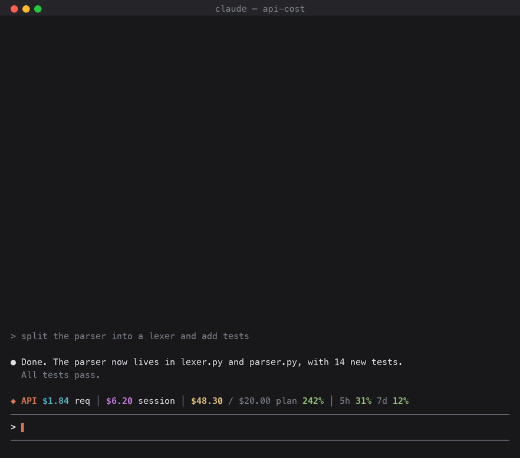

# api-cost

A Claude Code mod that shows what your usage would cost if you paid Claude API
list prices instead of a subscription: for the current request, the session,
and your billing month, compared with what your plan costs.



<sub>A mockup with sample data, drawn by `docs/make_gif.py` (Pillow): `python3 docs/make_gif.py docs/demo.gif`.</sub>

## Install

At the prompt of a Claude Code terminal session:

```
/plugin install api-cost --marketplace OWNER/api-cost
```

Answer `y` to add the marketplace, then press Enter to install for your user.

From a shell:

```
claude plugin install api-cost --marketplace OWNER/api-cost
```

In the desktop app: click **+** next to the prompt box, then **Plugins**,
**Add marketplace** with `OWNER/api-cost`, then **Add plugin**.

This repository is private: you need read access on GitHub, and a git
credential for github.com on your machine (an SSH key, or `gh auth login`
then `gh auth setup-git`).

Needs `python3` (on macOS it comes with the Xcode command line tools).

## What it shows

- **The band above the prompt**: the last request, the session, the billing
  month against your plan, and your 5-hour and weekly usage limits.
- **`/api-cost`**: the same in a panel, with your plan and the session by model.
- **`/api-cost month`**: the billing month by day, by project and by model.

## How it counts

Everything is read from Claude Code's own transcripts in `~/.claude/projects`,
so the month includes sessions from before you installed the mod. Each API
response is counted once and priced on its own model:

- input, output and cache reads at each model's list price;
- cache writes at 2x input for 1-hour entries (what Claude Code writes) and
  1.25x for 5-minute entries;
- fast mode at 2x, web searches at $10 per 1,000;
- Haiku 5.5 prompts over 100K tokens at its higher tier.

Prices are those of 2026-10-06. Nothing leaves your machine.

## Settings

All in `/config`, under api-cost:

| Setting | Default | |
| --- | --- | --- |
| Billing day | 0 (auto) | The day your subscription renews; auto reads it from your Claude login. |
| Plan price | 0 (auto) | USD per month; auto reads the plan from your Claude login (Pro $20, Max $100 or $200). |
| Price overrides | empty | JSON of model prefix to `[input, output, cache read]` USD per million tokens, e.g. `{"opus-5-5": [4, 20, 0.2]}`. |

Auto-detection reads three fields of `~/.claude.json` (the plan, its usage
tier and when the subscription started), never your name or email. The renewal
day is a guess from the start date: set it yourself if you changed plans.
